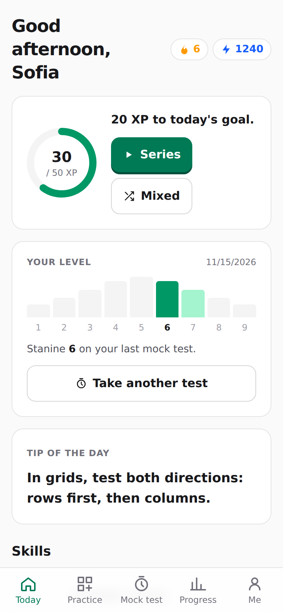
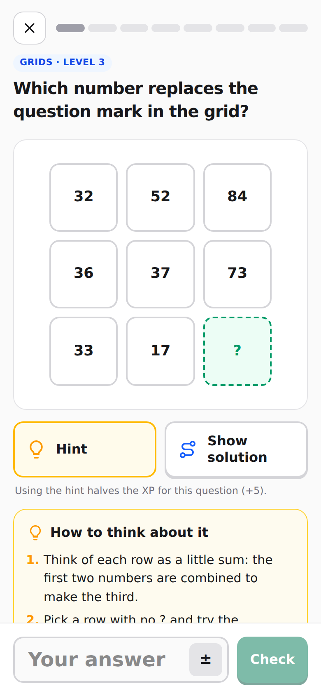
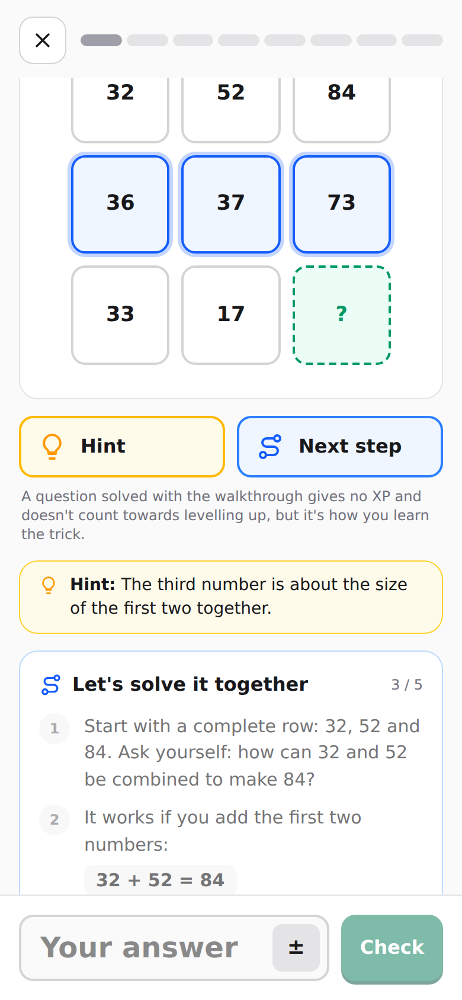
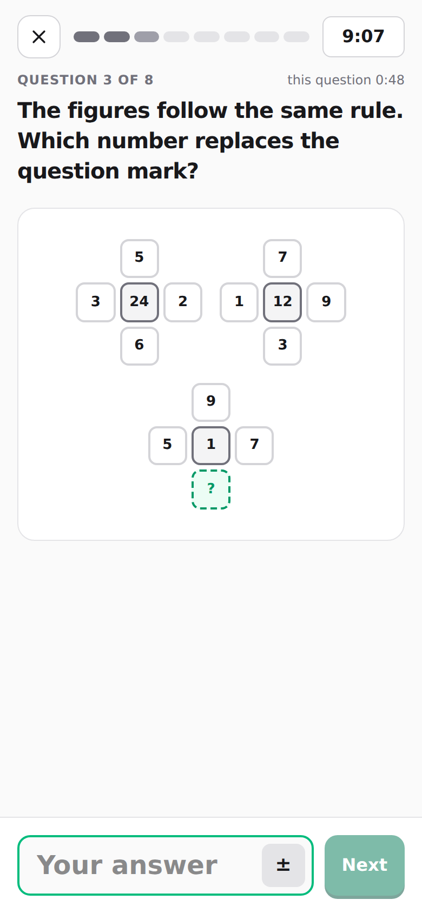
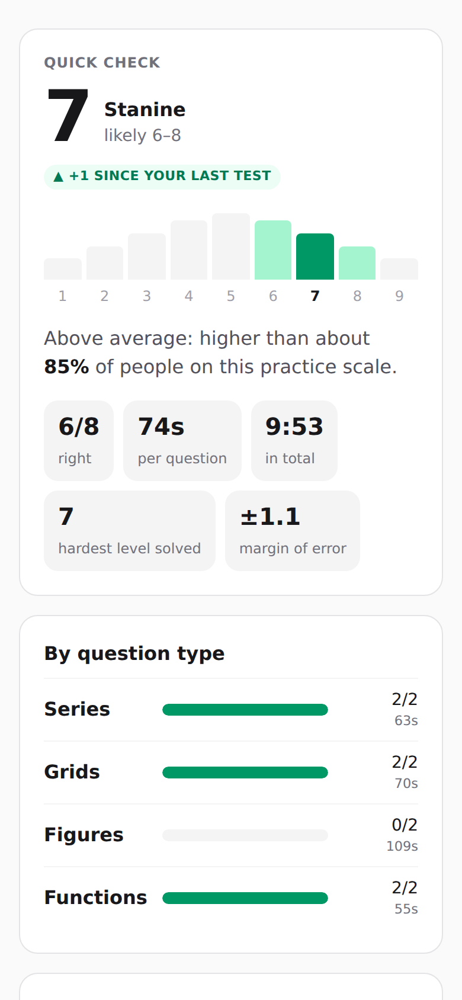
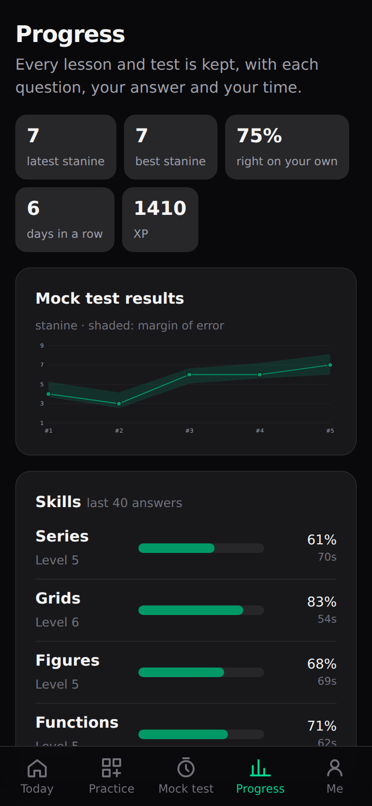
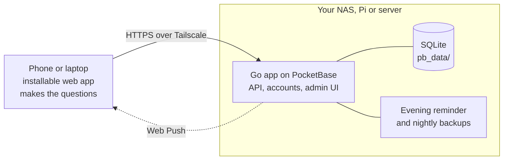

<div align="center">


# Reckon

**Practise the numerical reasoning tests that job applications ask for, on your own hardware.**

[](https://scorecard.dev/viewer/?uri=github.com/selfhostit/reckon)

</div>

Many employers ask candidates to sit a numerical reasoning test before an interview: rows of
boxes, grids and figures with one number missing, against the clock. The score lands in a
report next to your CV, on a 1–9 scale, and an average result can decide whether you get
the interview. These tests reward practice, but real practice material is hard to find, and
what there is often trains the wrong thing.

Reckon is a self-hosted trainer for exactly these questions. It makes endless new ones at
nine levels of difficulty, explains each one in plain language when you're stuck, and runs
adaptive mock tests that place you on the same 1–9 scale the reports use. Think Duolingo for
the numbers test: short daily lessons, levels, a streak, and a clear picture of how you're
improving.

<table>
  <tr>
    <td align="center" width="33%"><br><sub><b>A few minutes a day.</b> A daily goal, a streak and where to continue.</sub></td>
    <td align="center" width="33%"><br><sub><b>Stuck? Ask for a hint.</b> How to think about it, without the answer.</sub></td>
    <td align="center" width="33%"><br><sub><b>Or walk through it.</b> One step at a time, with the boxes highlighted.</sub></td>
  </tr>
  <tr>
    <td align="center"><br><sub><b>Mock tests like the real one.</b> Adaptive, timed, no help.</sub></td>
    <td align="center"><br><sub><b>A score you'll recognise.</b> A stanine, its margin of error and what to work on.</sub></td>
    <td align="center"><br><sub><b>See yourself improve.</b> Every session kept, in light and dark.</sub></td>
  </tr>
</table>

Reckon is new: version 0.1 has the four question types, lessons, mock tests and progress.
[docs/plan.md](docs/plan.md) explains how questions and scores are made, and what comes next.
Reckon is built on [plasto](https://github.com/selfhostit/plasto).

## Install

On a NAS, a Raspberry Pi or any Linux machine with a terminal (or SSH):

```sh
curl -fsSL https://github.com/selfhostit/docs/releases/latest/download/install.sh | sh -s -- reckon
```

This is the installer for every selfhostit app, set to install only Reckon. It sets up Docker
if it is missing, installs a pinned release of Reckon and checks every file against its
SHA-256, and can give Reckon an `https://` address with Tailscale, so it opens on your phone
at home and away. When it is done, open the address it lists, type the setup code and make
your account. Reckon needs no other selfhostit app.

Step by step for a [Pi or Linux](https://github.com/selfhostit/docs/blob/main/linux.md),
a [Synology](https://github.com/selfhostit/docs/blob/main/synology.md) or
[another NAS](https://github.com/selfhostit/docs/blob/main/other-nas.md), and
[after you install](https://github.com/selfhostit/docs/blob/main/first-steps.md): adding the
rest of your household, putting Reckon on your phone, and what to try when it doesn't open.

## How it works

**Four kinds of question**, the ones these tests are made of. Each has nine levels, from
"add 5 each time" to two series woven together:

| | What you see | What it trains |
|---|---|---|
| **Number series** | A row of boxes, one missing | Changes between neighbours, multiplying, two series mixed together, squares and cubes |
| **Number grids** | A 3 × 3 grid, one missing | One rule that holds for every row, or every column |
| **Number figures** | Crosses and triangles of numbers | How the outer numbers make the centre |
| **Function boxes** | Inputs and outputs | Finding the one hidden operation, and working backwards |

**Lessons** are eight questions with instant feedback: two to warm up, five at your level and
one challenge. Get six right on your own and that skill moves up a level. Under every question:

- **Hint** explains how to think about this kind of question, plus a pointer for this one that
  doesn't give the answer away. A right answer with the hint earns half the XP.
- **Show solution** walks through it one step at a time, in plain language, highlighting the
  boxes each step is about, until you type the answer yourself. That question earns no XP,
  but you've learned the trick.

**Mock tests** work like the real ones: 15 questions in 30 minutes (or a quick 8 in 12), no
help, and each question picked to match the ability you've shown so far, so most people get
about half right. Your result is a **stanine** from 1 to 9 with its margin of error, the
hardest level you solved, your pace and your score per question type, then a suggestion of
what to practise. After a strong test, your practice levels move up to match.

**Progress** keeps every lesson and test, with each question, your answer and your time:
your test results over time, accuracy and pace per question type, and four weeks of
activity. Open any session to see every question again with its worked solution.

The stanine is a practice estimate from the questions' built-in difficulty, not an official
norm score: use it to follow your own progress, and expect real tests to differ by about one
stanine. [docs/plan.md](docs/plan.md#scoring) explains the scoring.

## Your data

- **Private to each person.** Everyone on the server has their own account and their own
  practice; nobody else can see it, not even the owner. The access rules are tested
  (`backend/app/practice_test.go`).
- **On your machine.** Questions are made in the browser and results are saved in `pb_data` on
  your server, with a nightly backup kept there. No analytics, no tracking, no selfhostit
  account and no third-party service.
- **Yours to take or delete.** **Me → Your data** downloads everything as a file, or starts
  again from scratch. Removing a person removes their practice too.

## Develop

To work on Reckon itself, you need [Go](https://go.dev/dl/) 1.27+, [Node](https://nodejs.org) 22+ and
[uv](https://docs.astral.sh/uv/) (for the Python workers of the template; Reckon has none yet).

```sh
make setup   # install dependencies
make dev     # backend on :8090, web app with live reload on http://localhost:5173
```

Open the app and create your account with the setup code that `make dev` prints:
you become the **owner** and can also sign in to the admin UI at http://localhost:8090/_/ with the same
email and password. Add more people in the app: open **Me**, tap **People**, add their
name and email, and send them the message it shows with their password.

The question engine is `web/src/lib/engine.ts`, with no dependencies; its tests generate
thousands of questions at every level and check that every worked sum in every solution adds
up (`npm test` in `web/`). The rules of the game (levels, XP, streaks, scores) are in
`web/src/lib/practice.ts`.

## What you get

- **First-run setup and sign-in.** The first account is made on a setup screen, with a
  one-time code from the installer or the app's log, so nobody else can claim a fresh install.
- **Accounts for your household.** The owner adds people, gives them a new password and
  removes them on the People screen; everyone can change their own password. Nobody can sign
  themselves up.
- **An evening reminder** at 19:00, for people who turn it on, when their streak would break
  tonight: a push notification straight from your server, with no third-party service.
  Phones need the app on HTTPS.
- **Nightly backups** of the database at 03:00, keeping the last 7, in `pb_data/backups`.
  Change the schedule or add S3 storage in the admin UI under Settings > Backups.
- **An installable app.** It installs to a phone's home screen or a desktop, opens offline
  from its cached shell, and follows the system's light or dark mode.

## How it fits together



Questions are generated and scored in the web app, so practice keeps working smoothly on a
slow connection; the Go app stores each person's progress and sessions and enforces who can
read them.

## Deploy on its own

Reckon's own installer is an alternative to [the one above](#install): it gives Reckon its own
Tailscale machine, `https://reckon.<your-tailnet>.ts.net`, signed in with an auth key. It runs
from `main` and takes the newest release, without the SHA-256 checks of the shared installer.
On any Linux machine with Docker:

```sh
curl -fsSL https://raw.githubusercontent.com/selfhostit/reckon/main/deploy/install.sh | sh
```

See [docs/deploy.md](docs/deploy.md) for updates, backups, Synology and the Pi.

## Layout

```
backend/            Go app on PocketBase
  app/              routes, hooks and the streak reminder (start here)
  migrations/       database schema as code: progress and practice sessions
  jobs/             scheduled jobs with catch-up
  push/             Web Push: keys, subscriptions, sending
web/                Svelte 5 + Tailwind web app
  src/lib/engine.ts the question engine: generators, hints, solutions, adaptive scoring
  src/lib/practice.ts levels, XP, streaks and scores
  src/components/   screens: Today, Lesson, MockTest, Result, Review, Progress, Me
  scripts/          the screenshot script CI runs on every pull request
deploy/             compose files, Tailscale sidecar, install script, smoke test
docs/               the plan, the brand and the deploy guide
```

## Commands

| Command      | What it does                                          |
| ------------ | ----------------------------------------------------- |
| `make dev`   | Run everything with live reload                       |
| `make check` | Format, lint and type-check                           |
| `make test`  | Run the Go, web and worker tests                      |
| `make build` | Build `dist/reckon` with the web app next to it       |
| `make run`   | Build the Docker image and run it on :8090            |
| `make smoke` | Deploy the images with Compose and test end to end    |

Pushes to `main` publish `ghcr.io/selfhostit/reckon` for amd64, arm64 and armv7; a `v*` tag
publishes that version.

## Security and maintenance

- **Not on the internet:** the container listens on `127.0.0.1` only; reach it through
  Tailscale or your own reverse proxy with HTTPS (`deploy/docker-compose.yml`).
- **Locked-down container:** runs as a normal user, drops every Linux capability and
  can't gain new ones; its filesystem is read-only apart from its data.
- **Nobody claims a new install before you:** the first account needs the one-time setup
  code the install prints (`backend/app/setup.go`).
- **Private by rule:** each person's progress and sessions can only be read by them, and a
  finished session can't be edited (`backend/migrations/1762000000_practice.go`).
- **Sign-ins are rate limited** (10 a minute), and the web app sends a Content Security
  Policy (`backend/app/headers.go`).
- **Tested on every change:** Go and web tests and an end-to-end run of the published images
  (`make smoke`) in [CI](.github/workflows/ci.yml); Actions are pinned to commit hashes and
  Dependabot keeps Go, npm, Python, Docker and Actions dependencies current.
- **Security scans** on every pull request and every week: CodeQL, govulncheck on the
  Go code, Grype on the other dependencies and the released images, dependency review and
  gitleaks ([security.yml](.github/workflows/security.yml)).
- **Versioned releases:** installs update to a release, not to every change on `main`, and
  every image has a signed attestation of the commit and workflow that built it
  ([CHANGELOG.md](CHANGELOG.md), [docs/deploy.md](docs/deploy.md#check-where-an-image-came-from)).

Found a security problem? Please report it privately, not in an issue: see [SECURITY.md](SECURITY.md)
for how, and how quickly it gets fixed. [Security and privacy](https://github.com/selfhostit/docs/blob/main/security.md) covers every selfhostit app:
what protects an install, what you are trusting and what is not done yet.

## Support

If Reckon helps you land the job, you can [buy me a coffee](https://buymeacoffee.com/kalfasyan).

## License

MIT
